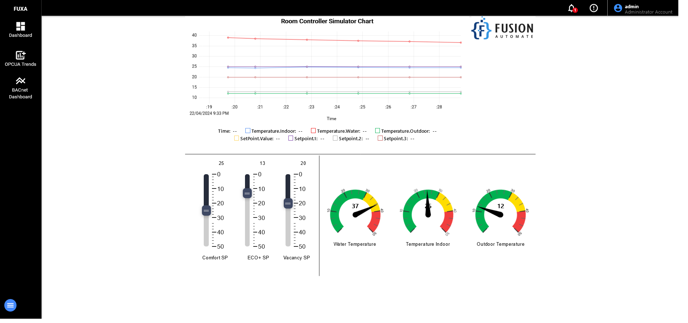
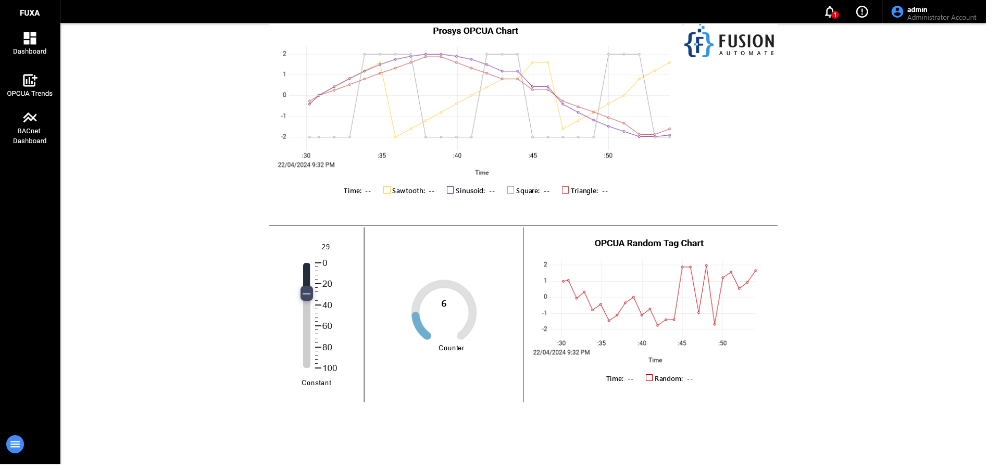
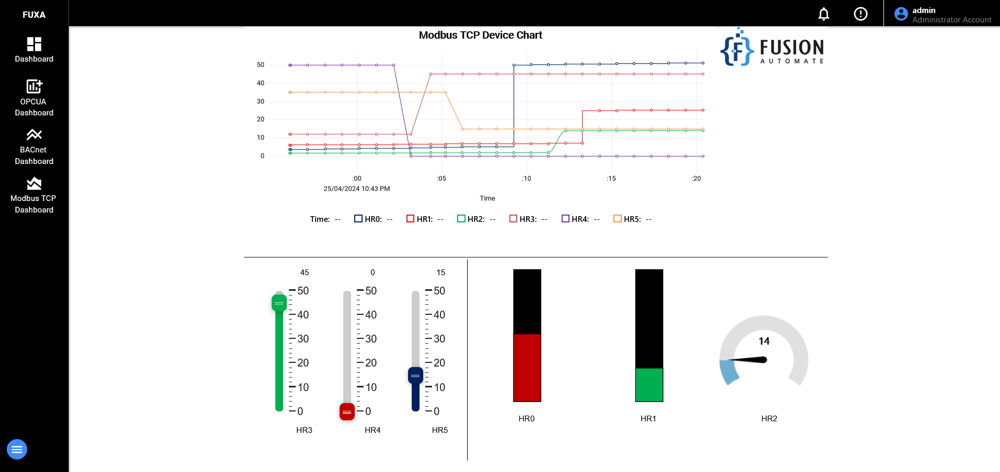
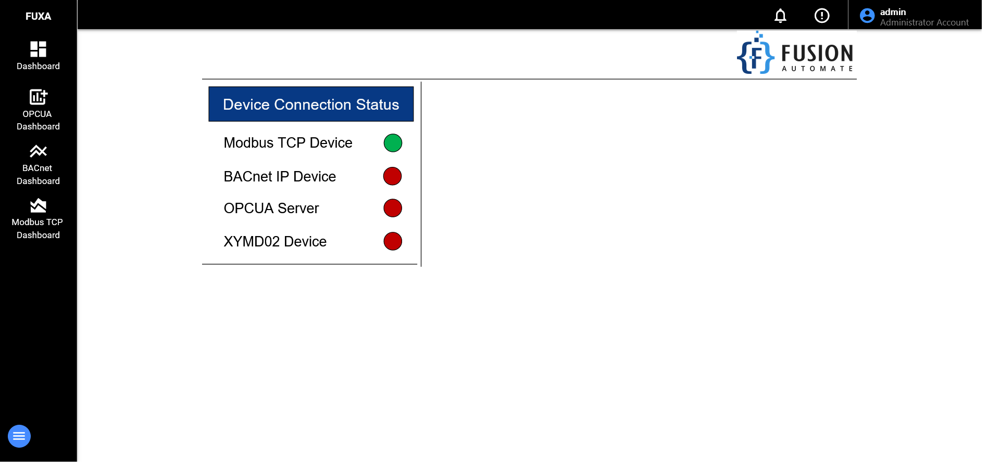
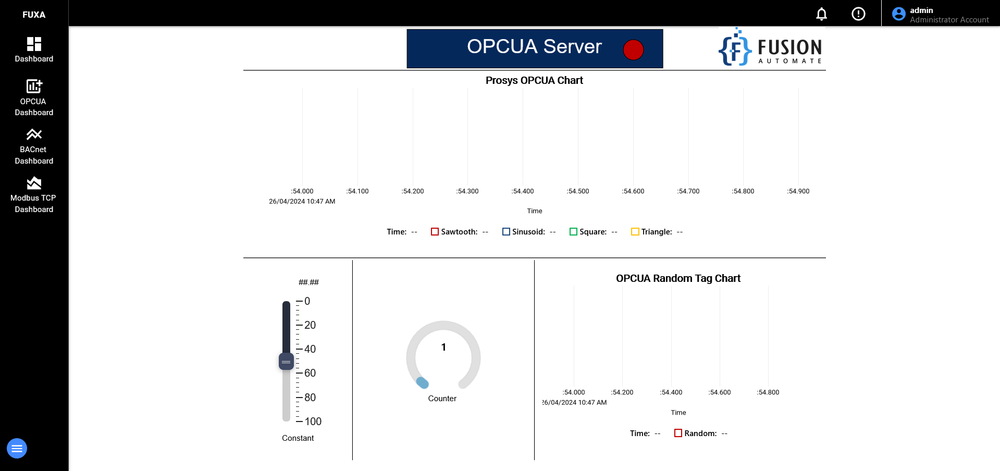
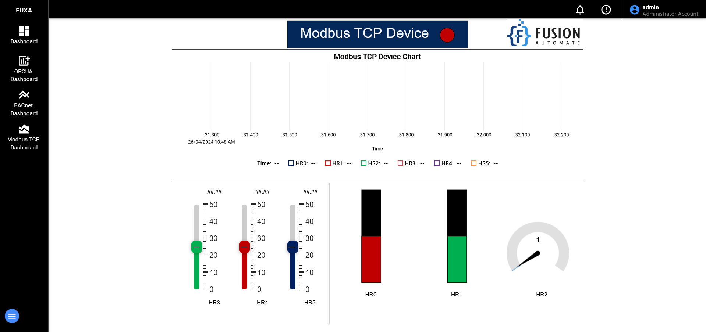

<h1 align="center">🌟 FUXA SCADA 🌟</h1>

  <em>FUXA web SCADA project backups — BACnet IP, OPC-UA and Modbus TCP dashboards with alarms, device status and user roles</em>

  
  
  
  
  

---

## Project Backup

- Created BACnet IP Device Dashboard + Created 2 Alarms for Indoor Temperature and Water Temperature + Added Admin, Manager, Operator User
    
    
    
    [FusionAutomate - 22042024.json](https://github.com/papercodeIN/FUXA_SCADA/blob/main/FusionAutomate%20-%2022042024.json)
    
- Added Dashboard for Prosys OPCUA Simulation Server
    
    
    
    [FusionAutomate - 22042024 - 1.json](https://github.com/papercodeIN/FUXA_SCADA/blob/main/FusionAutomate%20-%2022042024%20-%201.json)

- Added Device Connection Status in Main Dashboard for (OPCUA, Modbus TCP, XYMD02, BACnet IP)
    
    
    
    [FusionAutomate - 25042024.json](https://github.com/papercodeIN/FUXA_SCADA/blob/main/FusionAutomate%20-%2025042024.json)

- Added Dashboard for Modbus TCP Simulator Device using Modbus Slave
    
    
    
    [FusionAutomate - 25042024 - 1.json](https://github.com/papercodeIN/FUXA_SCADA/blob/main/FusionAutomate%20-%2025042024%20-%201.json)

- Added Device Connection Status in Modbus TCP Dashboard Page and OPCUA Dashboard Page
    
    
    
    
    [FusionAutomate - 26042024.json](https://github.com/papercodeIN/FUXA_SCADA/blob/main/FusionAutomate%20-%2026042024.json)

---

## 📞 Contact

| 📞 Method | 🔗 Details |
|-----------|-----------|
| Call / WhatsApp | [+91-9974477759](https://wa.me/919974477759) |
| Telegram | [@fusionautomate](https://t.me/fusionautomate) |
| Email | [eng.innovativ@gmail.com](mailto:eng.innovativ@gmail.com) |

## 💖 Support My Work

  

  ⭐ Star this repo if it helped you · 🔔 <a href="https://github.com/papercodeIN">Follow Fusion Automate</a>

